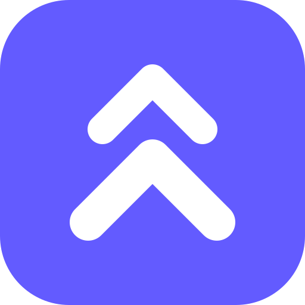

<div align="center">

<a href="https://founderizer.com"></a>

# Founderizer for Mac and iPhone

**The Mac and iPhone apps of [Founderizer](https://github.com/founderizer/founderizer): your own team of AI agents, on servers you own.**

[](LICENSE)
[](https://github.com/founderizer/founderizer-apps/releases/latest)
[](#what-you-need)

[Website](https://founderizer.com) · [Download&nbsp;for&nbsp;Mac&nbsp;and&nbsp;iPhone](https://platform.founderizer.com/download) · [Source&nbsp;of&nbsp;the&nbsp;hub](https://github.com/founderizer/founderizer)

</div>

## What you need

The Mac app runs on macOS 15 or later, and the iPhone app on iOS 18 or later. [Download them](https://platform.founderizer.com/download), or build them from this source:

<details>
<summary><b>Build the apps yourself</b></summary>

### What you need to build them

- A Mac with macOS 15 or later, and an Xcode that has the macOS 26 and iOS 26 SDKs or later ones: the source uses
  their APIs behind availability checks. The tests pass with Xcode 27.2. The apps run on macOS 15 and iOS 18 or
  later.
- A checkout of the hub repository. The Mac app's setup service carries the hub's `onboard.py`.
- For Fleet Vault only: an Apple Developer ID.

### The Mac app

```sh
swift test
```

runs the unit tests of the shared code (`FleetCore`, `FleetMark`) and of the vault (`FleetVaultCore`). A few vault
tests need the `age` and `age-keygen` programs.

```sh
git clone https://github.com/founderizer/founderizer.git ../founderizer
FLEET_KIT_SOURCE=../founderizer ./run.sh
```

builds a release build, makes `build/Founderizer.app` with the setup service inside it, signs it ad hoc and opens it.
Quit a copy of the app that runs before you open a new build.

```sh
./installer.sh
```

builds `build/Founderizer Installer.app`, signed ad hoc.

`run.sh` and `installer.sh` are for a run on your own Mac. An app that other people download must have your own
Developer ID signature and Apple's notarization.

The package also builds three helpers: the setup service (an XPC service inside the app), **Founderizer Installer**
(for a Mac that stays on and runs agents) and **Fleet Vault** (the helper that keeps secrets on a Mac).

### The iPhone app

Open `ios/FleetMobile.xcodeproj` in Xcode, choose an iPhone simulator and run. Or from a terminal:

```sh
cd ios
xcodebuild -project FleetMobile.xcodeproj -scheme FleetMobile \
    -destination 'platform=iOS Simulator,name=iPhone 16 Pro,OS=18.6' build
xcodebuild test -project FleetMobile.xcodeproj -scheme FleetMobile \
    -destination 'platform=iOS Simulator,name=iPhone 16 Pro,OS=18.6'
```

Name a simulator that your Xcode has. The project uses the package in the repository's root as a local dependency.
For a build on your own iPhone, set your own team and bundle identifiers in the project's signing settings.

### Builds that you sign yourself

Fleet Vault keeps its items in a keychain group, and the app accepts only a vault that the publisher's Apple team
signed. The team identifier `6EBZ756H9Q` (Amura Ventures SL's team) is therefore part of the source: in
`Sources/FleetVaultCore`, `Vault/`, `ios/Sources/SealedPing.swift`, `test-support/VaultKeychainProbe.swift` and the
signing settings of `ios/FleetMobile.xcodeproj` (`SECURITY.md` names it too). To ship builds of your
own, replace it with your team identifier in each of those places, and build the vault with your identity:

```sh
FLEET_SIGN_IDENTITY="Developer ID Application: Your Name (YOURTEAMID)" \
FLEET_VAULT_PROFILE=/path/to/your.provisionprofile python3 Vault/build.py
```

The relay at platform.founderizer.com sends a notification only to the builds that Founderizer publishes, so a build
that you sign yourself gets no notification from it.

</details>

## Licence

Founderizer is licensed under the Apache License, Version 2.0. See [`LICENSE`](LICENSE) and [`NOTICE`](NOTICE).

The name Founderizer and its logo belong to Azimut Ventures SL, and the licence gives no right to use them (section 6).
You can say that your work is based on Founderizer. A changed copy that you share uses a different name and a
different logo.

The provider logos in `Sources/FleetMark`, the chat app marks and the GitHub mark are the marks of their owners. The
apps show them only to name each one. The chat app and cloud provider marks are Simple Icons paths (CC0). The GitHub
mark's path is from Octicons, under the MIT License; its notice stands beside it in
`Sources/Founderizer/LibraryPages.swift`.

## Changes from outside

Issues and pull requests are welcome. [CONTRIBUTING.md](.github/CONTRIBUTING.md) says how a change gets in, and how to
test it before you send it.

## Credit

Created by Miguel Pieras, <https://x.com/mpieras>.

Copyright 2026 Azimut Ventures SL.
